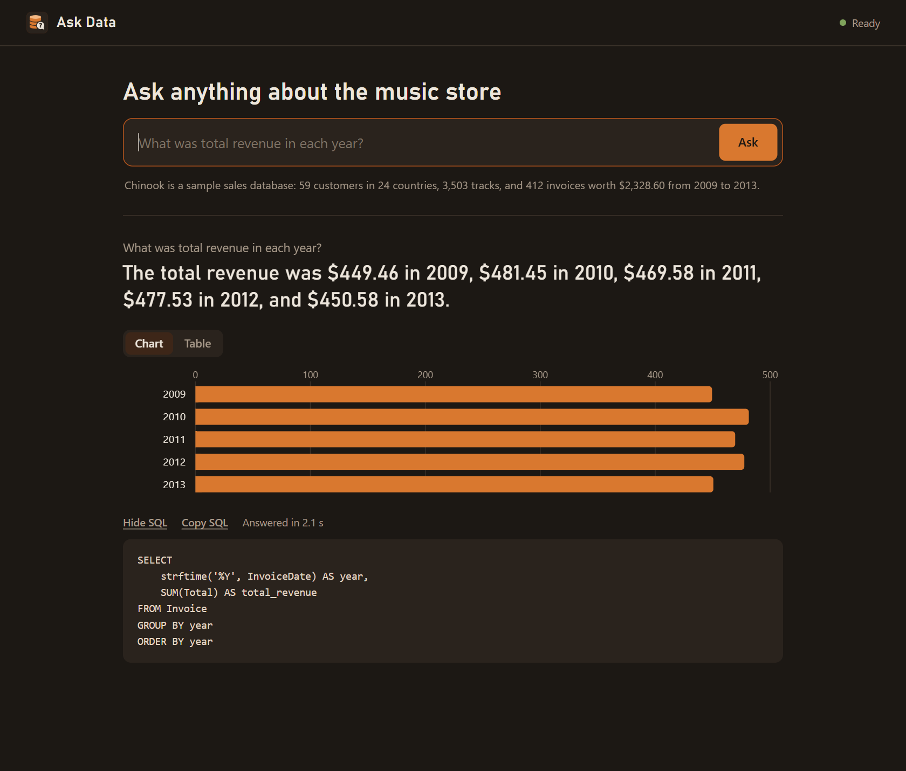

# Ask Data

Ask questions about a database in plain English and get answers backed by SQL. It runs on
Chinook, a public sample sales database for an online music store. A local LLM writes the query, a read-only guard runs it, and the answer comes back as a number,
a chart, a table or a description. Every query can be checked. An evaluation harness measures
how often the answers are actually right.



**The problem it addresses:** business teams wait on analysts for simple data questions. A
self-service tool only helps if people can trust it, so it shows its SQL, refuses questions the
data can't answer, never touches data it shouldn't, and has measured accuracy.

- **Runs fully locally.** `qwen3.6:27b` via Ollama on one RTX 4090. No data leaves the machine.
- **Measured accuracy.** **93.2% on first contact, with no dataset-specific tuning**, and 97.7%
  after two general rules (both on `qwen2.5-coder:32b`). The current default, `qwen3.6:27b`, scored
  42 and 43 of 44 in its latest two runs. Writing and running the SQL takes about 1 second (median), around 2 seconds at
  the 90th percentile; a full written answer in the app usually arrives in 2–3 seconds.
- **Nothing to set up but the model.** Chinook ships in the repo, so anyone can try it with just Ollama.
- **Knows when to say no.** It refuses questions the data can't answer instead of inventing an answer.
- **Built like a product.** A desktop app that starts and stops its own model server, plus a
  CLI and an eval runner.

## Results

### Chinook: does it generalize?

[Chinook](https://github.com/lerocha/chinook-database) is a public sample database for an online
music store: 59 customers, 8 employees, 412 invoices and 3,503 tracks. I wrote 44 business
questions with gold SQL ("Which sales support agent brought in the most revenue?", "Which
customers haven't purchased in the last 6 months?", "What share of revenue comes from the top
10 customers?") and committed them before running the model on this dataset.

| Version | Score (44) | What changed |
|---|---|---|
| v1 (untuned) | **41 (93.2%)** | Only an annotated schema; the shared prompt, written before this dataset, unchanged |
| v2 | 43 (97.7%) | Two shared rules: return names rather than IDs; total per item before averaging |

v1 is the real generalization number, since v2's rules came from reading v1's failures. Its
misses were new kinds of mistake: returning employee IDs instead of names, and averaging invoices
instead of per-customer totals (a grain error, which still fails).

### Which model?

Four local models, same prompt and pipeline, each loaded cold on the RTX 4090
([`evals/models/`](evals/models/2026-10-22-model-sizes.md) has the full table and every miss):

| Model | Chinook (44) | Median latency | Tokens/s | Memory |
|---|---|---|---|---|
| qwen2.5-coder 7B | 36 (82%) | 0.3 s | 157 | 5.1 GB |
| qwen2.5-coder 14B | 41 (93%) | 0.6 s | 84 | 10.4 GB |
| qwen2.5-coder 32B | 42 (95%) | 1.2 s | 41 | 21.8 GB |
| qwen3.6 27B | 44 (100%) | 0.9 s | 112 | 17.2 GB |

The 7B is four times faster than the 32B but misses 6 more questions. qwen3.6 was the most
accurate while running faster in less memory than the 32B.

**Tuning pass, then a switch.** I added general rules (one value per column, counting groups,
date math) and a pipeline check for "searched the wrong table", then ran both large models twice
([`2026-10-22-tuning-pass.md`](evals/models/2026-10-22-tuning-pass.md)). The switch rule was set
before the runs: move if qwen3.6 averages at least the 32B's accuracy.

| Model | Chinook (44), two runs | Median latency | Tokens/s |
|---|---|---|---|
| qwen2.5-coder 32B | 40, 40 | 1.1 s | 41 |
| **qwen3.6 27B** (now the default) | **43, 42** | 0.9 s | 110 |

The same changes made the 32B *worse* (42 → 40): rules refined for one model can cost another.
Repeated runs of the same model vary by about one question, so smaller gaps are noise.

## How it works

```
question ──► prompt: schema with column notes, real column values, today's date, rules
                │
                ▼
            local LLM (Ollama) ──► SQL ──► guard: read-only connection, SELECT-only
                ▲                            authorizer, one statement, 10 s, 500 rows
                │                                  │
     SQL error? send the error back ◄──────────────┤
     (up to 2 repairs)                             │
                                     no rows? retry with the closest real name 
                                                   │
                                                   ▼
                                     rows ──► LLM writes a 1-2 sentence answer
                                                   │
                                                   ▼
                              UI picks the form: number, bar chart, table or description
```

- **Ask** (`askdata/ask.py`). The prompt includes the schema with its comments and the actual
  values of categorical columns, so the model uses the real genre and media type names.
- **Datasets** (`askdata/datasets.py`). Everything specific to a database (the file, the
  annotated schema, domain rules, where names live, units, UI text, and an "as of" date for
  historical data) is one dataset definition. The pipeline itself is shared, so another
  database can be added without touching it.
- **Guard** (`askdata/guard.py`). Opens SQLite read-only and installs an authorizer that allows
  only reads. It also enforces one statement, a time limit and a row cap. A request like
  "Delete all the invoices from 2009" gets rejected. All of this is unit tested.
- **Recover names** (`askdata/names.py`). If a query matches nothing, the names it searched for
  are compared against real names, and the closest match is substituted ("Iron Maidan" →
  "Iron Maiden"). Only literals in `=`, `LIKE` and `IN` comparisons are touched.
- **Evaluate** (`evals/`). Runs the gold SQL and the model's SQL against the same database and
  compares the *result sets*, not the SQL text. Extra columns are allowed, numbers match within
  rounding, and genuinely ambiguous questions list alternative gold queries.
- **Desktop app** (`askdata/app.py`, `askdata/web/`). A standard-library HTTP server and a
  dependency-free HTML/JS front end, opened in a Brave app-mode window. Ollama and the window run
  in Windows kill-on-close job objects, so closing the window stops everything, even if the
  launcher crashes.

## What I learned

- **Refusal has to be designed.** Without an explicit way to decline, the model answers a nearby
  question or invents column names. It now replies `CANNOT_ANSWER` when the data isn't there,
  and the eval checks that it does.
- **Offering a way out at the wrong moment backfires.** When the *repair* prompt also offered
  "you may refuse", the model gave up on joins it could have fixed. Now the refusal option
  appears only in the first prompt.
- **Prompt changes have side effects.** Rules that helped one model made another worse. Without
  a fixed eval set, those regressions would have gone unnoticed.
- **A new dataset finds new failure types.** Chinook's first run returned employee IDs instead of
  names, a mistake the prompt had never been tested against.
- **The answer sentence needs its own checks.** With correct SQL and a correct chart, the
  sentence still claimed "$138.6 million" (the value was $138.60) and invented a total. The
  answer writer now states only numbers from the result and is told each dataset's units.
- **Evaluation has to be honest.** Gold answers are recomputed at run time, and the question set
  was committed before the first model run.

## Running it

You don't have to run it to see how it works: the screenshot and results above show it in action.

**To run it, you need:** Windows, [Python 3.12](https://www.python.org/downloads/),
[Ollama](https://ollama.com), and a GPU with about 24 GB of memory for the default model. The
model is a large download.

1. Install Python 3.12 and Ollama, and make sure Ollama is running.
2. On this page, click **Code**, then **Download ZIP**. Extract the ZIP and open the extracted folder.
3. Open PowerShell in that folder: click the folder's address bar, type `powershell` and press Enter.
4. Run these one at a time:

   ```powershell
   py -3.12 -m venv .venv
   .venv\Scripts\pip install -r requirements.txt
   ollama pull qwen3.6:27b
   ```

5. Double-click **`Ask Data.bat`**. It starts Ollama if needed and loads the model.
6. Ask a question, such as `Who are our top 5 customers by total spend?` You'll get the SQL, a
   results table and a written answer. The top customer should be Helena Holý at $49.62.
7. Press Enter on a blank line to quit.

### Other commands

Install the test tools first if you want to run the tests or evals:
`.venv\Scripts\pip install -r requirements-dev.txt`

| To | Run | Ollama |
|---|---|---|
| Ask in the terminal | `.venv\Scripts\python -m askdata.launcher` | Starts it for you |
| Open the desktop app (needs Brave) | `.venv\Scripts\pythonw -m askdata.app` | Starts it for you |
| Ask one question | `.venv\Scripts\python -m askdata.ask "Which genres sell best in the USA?"` | Must already be running |
| Use a smaller model | `.venv\Scripts\python -m askdata.ask --model qwen2.5-coder:14b "Which genres sell best in the USA?"` | Must already be running; pull the model first |
| Run an eval | `.venv\Scripts\python -m evals.run --label my-change` | Starts it for you |
| Compare models | `.venv\Scripts\python -m evals.compare_models qwen2.5-coder:14b qwen2.5-coder:32b` | Starts it for you |
| Run the unit tests | `.venv\Scripts\python -m pytest` | Not needed |

If `askdata.ask` fails with a connection error, Ollama isn't running. Start Ollama, or use
`Ask Data.bat`, which starts it for you.

## Project layout

```
askdata/
  datasets.py    what is specific to each database
  ask.py         question -> SQL -> answer, with repairs and refusals
  guard.py       read-only, single-statement, time- and row-limited execution
  names.py       typo recovery for names
  llm.py         Ollama client (8K context keeps the model in VRAM)
  launcher.py    terminal app: starts and stops Ollama
  app.py         desktop app: Ollama + web server + app window
  web/           HTTP API and the HTML/CSS/JS interface
datasets/chinook/
  chinook.db     Chinook v1.4.5 sample database (MIT license, see LICENSE.md)
  schema.sql     annotated schema the model reads
evals/
  questions/     chinook.toml (44 questions, with gold SQL)
  compare.py     result-set matching
  compare_models.py  accuracy, latency, memory and load time per model -> models/*.md
  run.py         scoring and reports
  RESULTS.md     version-by-version results
tests/           guard, matching, date idioms, typo recovery
```

## Privacy

Everything runs on the local machine. The app window uses its own Brave profile, with product
analytics and the usage ping turned off. Raw eval results (`evals/results/`) are gitignored.

## Deploying for a team

Ask Data is a single-user desktop app: the server listens only on `127.0.0.1`, has no sign-in,
uses a local GPU, answers one question at a time, and reads a SQLite file. For a remote team
working on real company data, I would change it like this:

1. **One central service behind company sign-in.** Host the web server on a company VM, behind
   HTTPS and single sign-on (Entra ID, Okta). Remote staff reach it through the VPN or a
   zero-trust gateway, never the open internet. Users open it in their own browser, so the app
   window and launcher go away.
2. **Read-only access to the warehouse.** Point it at the warehouse or a read replica, never the
   production database. Use a dedicated read-only role, and set statement timeouts and row
   limits in the database itself. Keep a SELECT-only check in code as a second layer, using a
   parser such as `sqlglot` instead of the SQLite authorizer.
3. **Permissions are the hardest part.** If every query runs as one service account, anyone
   who can type a question sees everything that account can. Instead, either run each query as
   the person asking, so the database's row-level security applies, or give each role its own
   curated dataset of views. The prompt includes sample column values and the answer writer
   sees result rows, so those must be scoped per user too.
4. **Choose where the model runs.** Self-hosting on a GPU server with vLLM handles concurrent
   users far better than Ollama, and no data leaves the company. A hosted model (for example
   Claude through Amazon Bedrock with zero data retention) is cheaper to run and more accurate, but
   schemas and result rows leave the building, so it needs security and legal sign-off.
5. **Audit and feedback.** Log who asked what, the SQL that ran and how many rows came back.
   Add a "this answer was wrong" button and turn real questions into an eval set for that
   database: accuracy on Chinook says little about a new schema.
6. **Code changes.** Authentication, a job queue in place of the single work lock, a database
   connection layer, and dialect-specific versions of the guard and the prompt's date idioms.

**Build or buy:** at many companies the right answer is the data platform's own tool
(Snowflake Cortex Analyst, Databricks Genie, Power BI Copilot), which already handles sign-in,
permissions and auditing. A custom tool earns its keep when the data lives outside those
platforms, or when the team needs control over the prompts and the evaluation.

## Limitations and next steps

- Known failure: the per-customer average is still computed per invoice (h05).
- Next: add held-out questions written by someone else; measure time saved against writing the SQL by
  hand; run each eval several times to report accuracy as a range instead of a single number.

## License

MIT, see [LICENSE](LICENSE). The Chinook sample database has its own MIT license:
[`datasets/chinook/LICENSE.md`](datasets/chinook/LICENSE.md).
